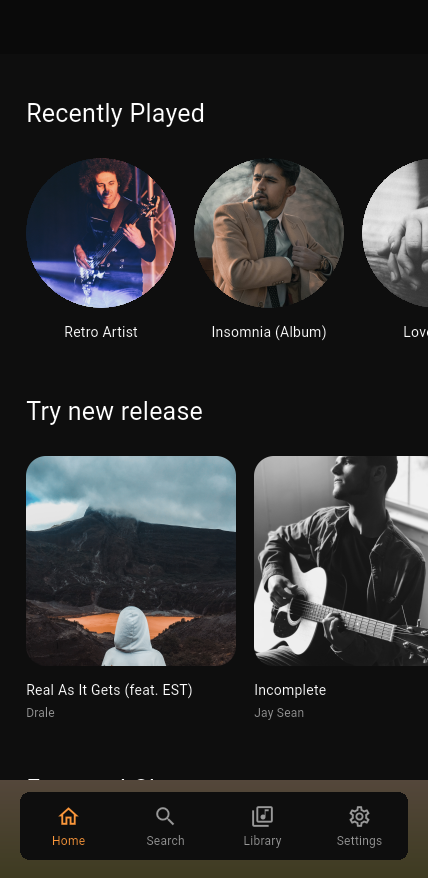
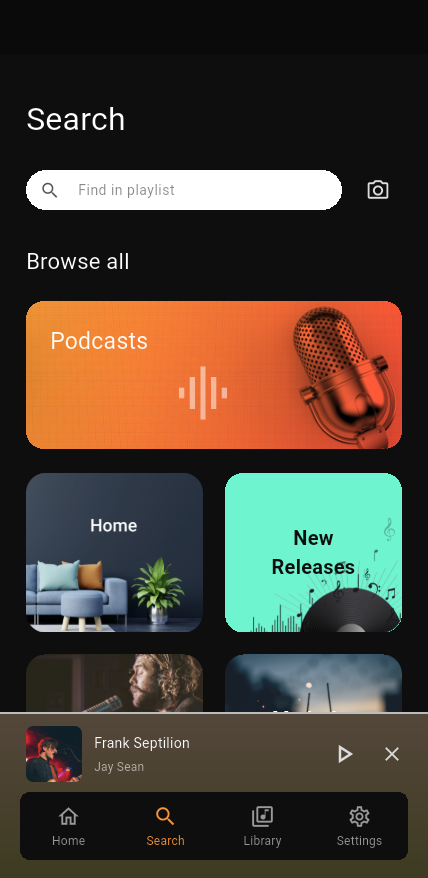
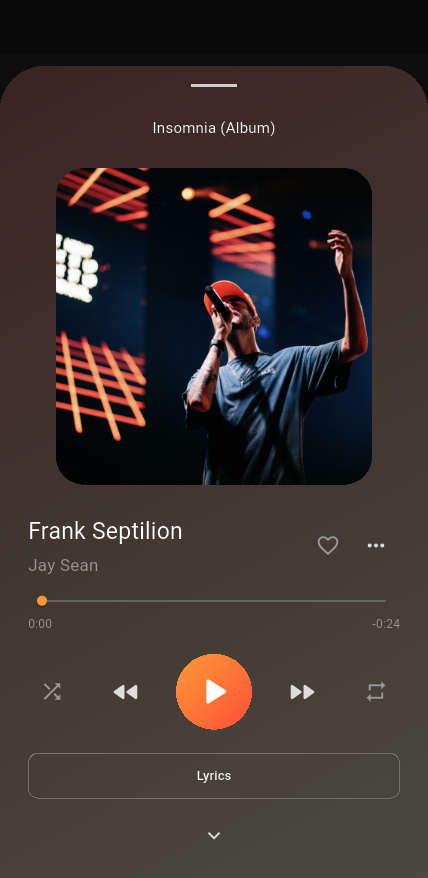
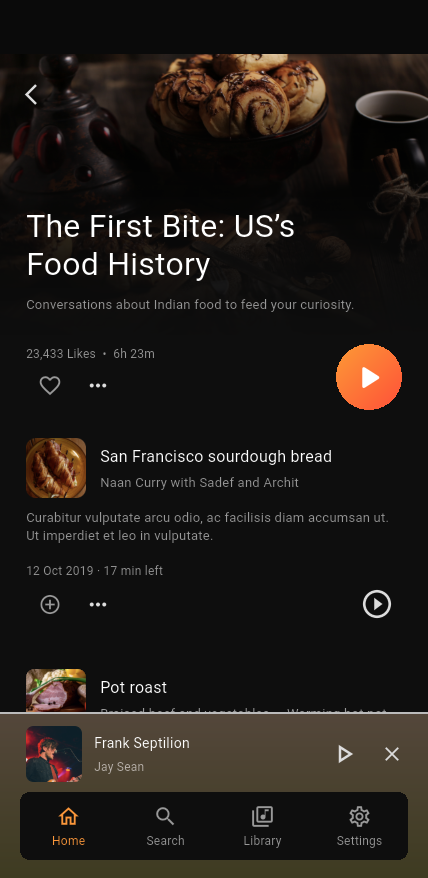
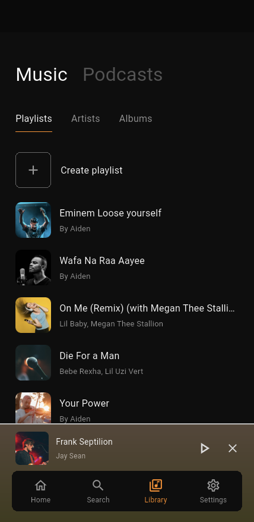
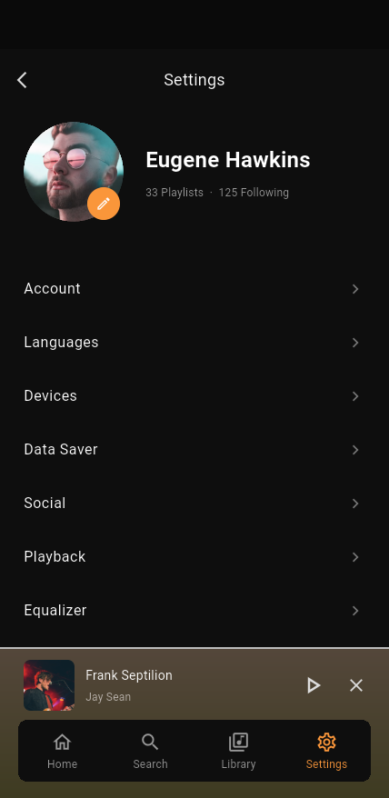
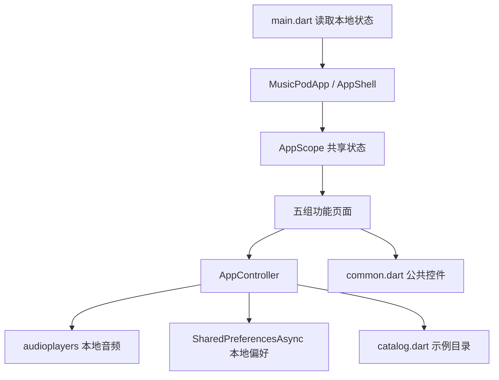

# MusicPod

基于 Pixso「MusicPod」设计稿开发的 Flutter 音乐与播客 App。现已加入 Supabase + GitHub 登录、Jamendo 独立音乐和公开播客 RSS 的在线服务实现，并保留原来的 26 页本地演示模式。

## 在线服务配置（从这里开始）

**[免费服务图文配置指南](docs/SERVICE_SETUP.md)** 包含注册与后台页面链接、获取 Key 的位置、5 张设置示意图、GitHub 回调配置、数据库初始化、网页版 RSS 转发部署及验收清单。

```powershell
# 首次创建配置；编辑 local.json 填入自己的三个值
Copy-Item config/example.json config/local.json
flutter pub get
flutter run -d chrome --web-port=7357 --dart-define-from-file=config/local.json
```

默认启动在线版。未配置时会提示服务尚未连接，允许游客使用已配置的功能，不会把示例音频当作真实歌曲。账号配置和服务部署请按图文指南完成，当前联调状态见 `docs/VALIDATION.md`。

界面支持 **English / 简体中文 / 日本語**，默认跟随设备。在 **Settings → Languages → App language（设置 → 语言 → 界面语言）** 中可随时切换并保存；歌曲和播客内容保留原文。[界面语言说明](docs/LOCALIZATION.md)

- 在线版：真实音乐搜索、HTTPS 在线播放、收藏、自建歌单、最近播放、RSS 订阅及单集播放；资料库本地缓存、按用户隔离，并通过 Supabase 同步。
- 游客资料库与账号资料库分开保存，不自动合并。云端采用快照同步和后写覆盖；离线修改保留在本机，可手动重试同步。
- 公开音乐请求仅使用 Jamendo 应用 Client ID；GitHub Client secret 只保存在 Supabase 后台。数据库按用户启用 RLS。客户端只接受 Supabase Publishable key。
- 音乐和播客音频直接由源站提供；“保存单集”只保存收听标记，没有离线下载。免费方案限非商业和服务额度内使用。
- 以下截图、演示 PIN 和最初的验证记录对应本地演示模式；运行 `flutter run --dart-define=MUSICPOD_DEMO=true` 可继续体验。`dist/` 的 APK 也是旧演示包。

## 主要界面

以下图片为 **Android 模拟器中的 App 实际运行截图**；Pixso 原稿另存于 `docs/reference/`。

| 首页 | 搜索 | 播放器 |
| --- | --- | --- |
|  |  |  |

| 播客详情 | 资料库 | 设置 |
| --- | --- | --- |
|  |  |  |

[查看全部 26 个界面及滚动补充截图](docs/GALLERY.md) · [查看设计稿节点与代码对应表](docs/DESIGN_MAP.md)

[下载 Android ARM64 演示安装包（26.5 MB）](dist/musicpod-android-arm64.apk) · [查看验证记录](docs/VALIDATION.md)

## 原始本地演示的功能与演示方式

- **注册**：手机号校验、4 位 PIN 校验、重新提示 PIN、跳过注册。演示 PIN 为 **1234**，不发送短信。完成后会保存登录引导状态。
- **音乐发现**：最近播放、新发行、排行榜、推荐横向列表、专辑详情、专辑内搜索及排序。
- **播放器**：本地音频真实播放/暂停、拖动进度、上一首/下一首、随机、单曲重复、收藏、隐藏当前歌曲、添加队列和添加歌单。
- **队列**：点选播放、拖动排序、多选删除，与迷你播放器共享播放状态。
- **搜索与播客**：按歌曲或歌手实时搜索、空结果提示、分类浏览、播客详情、单集播放和本地保存标记。
- **资料库**：歌单、歌手、专辑、播客单集、已保存内容；支持创建歌单、添加歌曲及选择喜欢的歌手。
- **设置**：编辑用户名和邮箱、英中日界面切换、独立的音乐语言偏好、流量节省、社交、播放设置、均衡器开关及预设曲线。
- **本地保存**：引导状态、资料、收藏、自建歌单及曲目、歌手和语言偏好、播客保存标记、设置项及均衡器预设。

### 演示范围

本项目交付可运行的 UI 和本地交互，不依赖服务端。设计稿中的歌手、曲名和封面用于还原界面，所有播放入口共用项目内的 **24 秒原创合成器试听音频**，不包含对应商业歌曲或真实播客录音。

“Downloads”展示本地保存标记，试听文件已随 App 打包，不执行远程下载。音乐内容语言偏好与英中日界面语言分开设置，不会自动翻译节目。流量节省、社交、音频标准化、单声道和均衡器等设置保存本地状态；演示模式不连接内容服务、社交服务或 DSP 音效引擎。自动播放、随机和重复会实际影响试听播放。设备页显示当前设备，订阅页提供演示说明，不进行购买。

## 项目结构与架构

```text
MusicPod/
├── lib/
│   ├── main.dart               # 初始化、读取本地状态、启动 App
│   ├── app.dart                # 应用外壳、26 个页面入口、返回栈与底部栏
│   ├── core/
│   │   ├── catalog.dart        # 页面枚举、Track 模型、设计稿示例目录
│   │   ├── controller.dart     # 导航、播放、队列、搜索、歌单与本地保存
│   │   └── theme.dart          # 统一颜色、渐变、文字与控件主题
│   ├── features/
│   │   ├── auth.dart           # 启动、手机号注册、验证码
│   │   ├── discover.dart       # 首页、搜索、播客及单集卡片
│   │   ├── playback.dart       # 专辑、排序、播放器、更多选项、队列
│   │   ├── library.dart        # 资料库五类页面、选歌手、歌单操作
│   │   └── settings.dart       # 设置、账户、语言、偏好与均衡器
│   └── widgets/common.dart     # 图片、按钮、标题、搜索、歌曲行与底部栏
├── assets/
│   ├── images/                # 直接从 Pixso MCP 导出的独立图片和 Logo
│   ├── fonts/                 # Roboto 字体及许可证
│   └── audio/preview.wav      # 原创本地试听音频
├── test/                      # 状态逻辑、注册及三种屏宽的全页面检查
├── integration_test/          # Android 真机环境流程、音频和存储验证
├── tool/screenshot_driver.dart # 运行截图保存工具
├── docs/
│   ├── DESIGN_MAP.md          # 26 个设计节点 → 页面代码 → 截图
│   ├── GALLERY.md             # 全界面截图索引与预览
│   ├── VALIDATION.md          # 环境、验证结果与限制
│   ├── assets.json            # 图片资源与 Pixso 来源节点
│   ├── reference/             # 26 张 Pixso 原稿
│   └── screenshots/           # 26 张 App 截图与滚动补充图
├── android/ ios/ macos/ web/   # Flutter 平台工程
└── pubspec.yaml / pubspec.lock # 依赖声明与版本锁定
```

使用 Flutter 自带的 `ChangeNotifier` + `InheritedNotifier` 管理状态。`AppController` 处理本地演示与共享播放能力；`LiveController` 处理在线目录、RSS、账号隔离及资料库同步。在线页面位于 `lib/features/live.dart`，服务访问层位于 `lib/services/`。



`AppScreen` 为每张设计稿提供独立入口。底部四栏切换主分类；专辑、播放器和设置子页使用轻量返回栈。底部播放器与完整播放器共享同一个音频实例。排序浮层覆盖专辑页，播放器、队列、验证码和选择歌手等界面采用全屏布局。列表支持滚动，宽屏居中限制最大内容宽度，图片按可用空间适配。

代码按功能合并相近页面，复用歌曲行、设置开关、播放器控制栏和公共主题。服务依赖为 `supabase_flutter`、`http`、`xml`、`url_launcher`；播放与本地缓存使用 `audioplayers` 和 `shared_preferences`；界面语言使用 Flutter SDK 的 `flutter_localizations` 和项目内的文案资源。

## 运行

在线版开发验证环境：Flutter **3.47.7**、Dart **3.13.5**；原本地演示使用 Flutter 3.41.6 / Dart 3.11.4。依赖锁定文件已保留。

```bash
flutter pub get
flutter run -d emulator-5554 --dart-define=MUSICPOD_DEMO=true
```

首次启动显示注册流程，可输入 7–15 位数字手机号，再输入 `1234`，或点击 `Skip`。后续启动进入首页。

其他平台演示可加 `--dart-define=MUSICPOD_DEMO=true` 运行；在线版按上方图文指南配置。本次验证记录见 `docs/VALIDATION.md`，远端账号授权和各目标设备仍需配置后联调。

```bash
# 静态检查和本地测试
flutter analyze
flutter test --enable-vmservice --concurrency=1

# Android 模拟器完整流程及全部截图
flutter drive --driver=tool/screenshot_driver.dart \
  --target=integration_test/app_test.dart -d emulator-5554

# 构建 ARM64 安装包
flutter build apk --release --target-platform android-arm64 --split-per-abi
```

截图命令需要先启动 Android 模拟器，结果写入 `docs/screenshots/`。自动化测试使用独立的内存界面数据，不会把测试歌单加入正常演示目录；存储验证会写入并恢复演示账户的默认用户名与流量设置。

## 后续范围

在线服务实现与配置文件已经加入，待用户提供自己的服务配置后联调。离线下载、设备投放、订阅购买、社交服务及 DSP 均衡器仍未实现。项目未配置生产签名，原交付 APK 用于本地开发演示。
