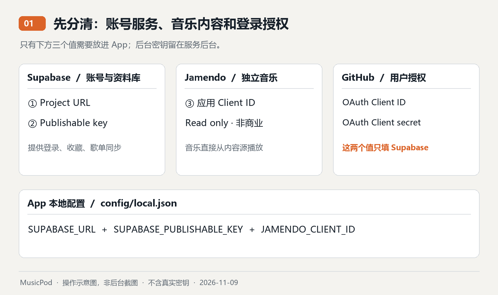
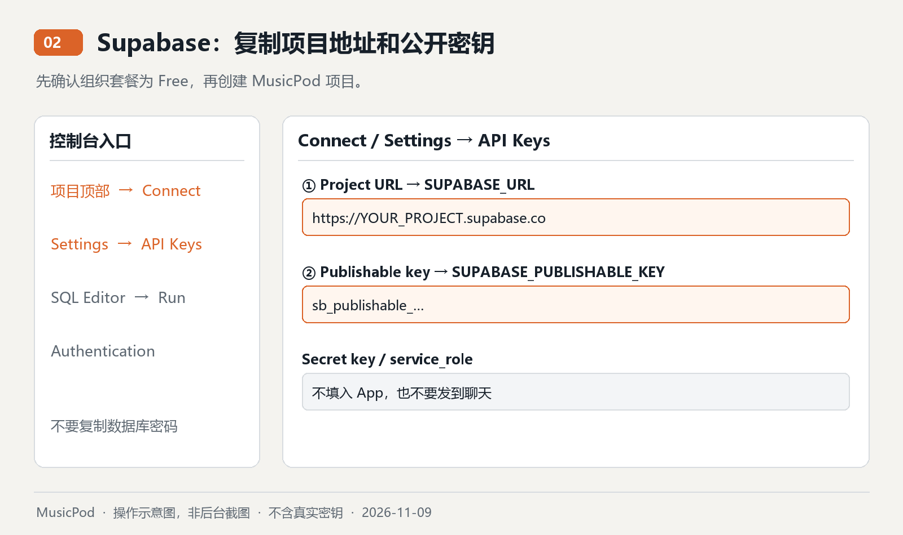
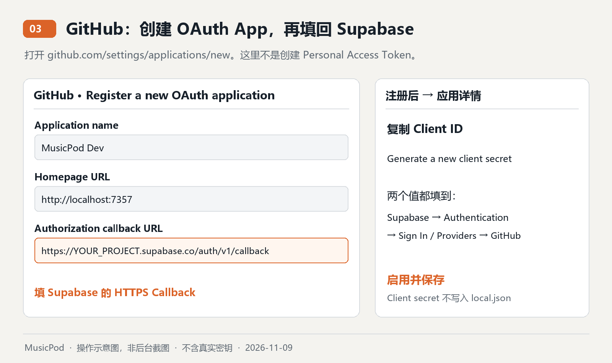
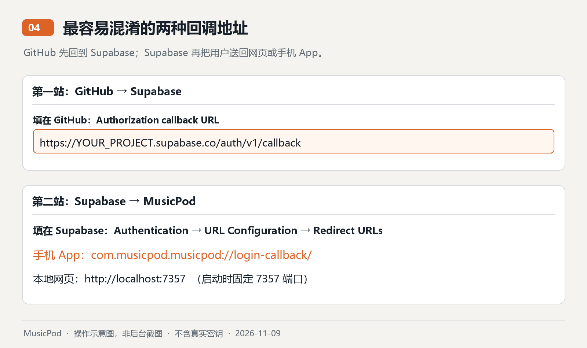
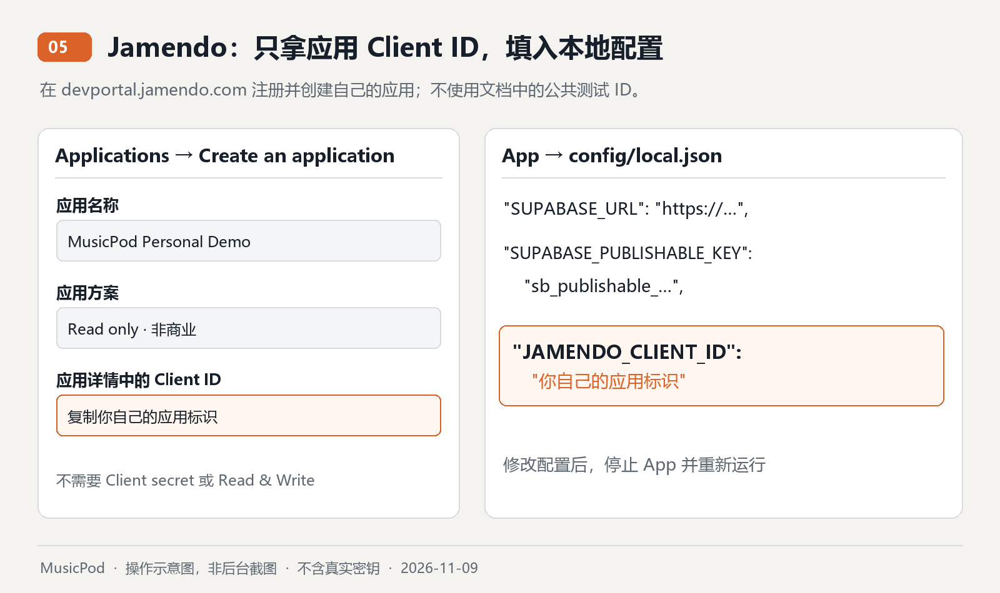

# MusicPod 免费服务配置指南

更新：2026-11-09。目标是个人学习、非商业演示和小范围试用，服务费用保持在免费额度内。

项目已加入在线服务代码、数据库初始化文件和配置模板。**你仍需在自己的账号中创建项目、获取应用标识并完成下列设置；未填写配置不代表已经联网成功。** 文中所有图片均为按官方文档整理的操作示意图，不是你的后台截图；后台改版时以文字路径和官方文档为准。

## 1. 先准备什么



| 内容 | 去哪里打开 | 用途 | 最后填在哪里 |
| --- | --- | --- | --- |
| Supabase 账号与 Free 项目 | [Supabase 控制台](https://supabase.com/dashboard) | 登录、保存收藏和歌单 | 项目配置 + 数据库初始化 |
| Supabase Project URL | 项目顶部 **Connect** | 找到你的项目 | `SUPABASE_URL` |
| Supabase Publishable key | **Connect** 或 **Settings → API Keys** | App 的公开访问标识 | `SUPABASE_PUBLISHABLE_KEY` |
| GitHub OAuth App | [创建 OAuth App](https://github.com/settings/applications/new) | 让用户用 GitHub 登录 | Client ID、Client secret 只填 Supabase 的 GitHub 提供商设置 |
| Jamendo 开发者账号 | [注册](https://devportal.jamendo.com/signup) | 创建音乐接口应用 | 账号本身不填入 App |
| Jamendo 应用 Client ID | [应用管理](https://devportal.jamendo.com/admin/applications) | 搜索和播放独立音乐 | `JAMENDO_CLIENT_ID` |
| 播客 RSS 地址 | 节目发布方提供的公开 HTTPS RSS | 获取节目与音频地址 | App 的 **Podcasts → Add RSS feed** |

你只需要向本地 App 配置填入 **3 个值**：Supabase URL、Supabase Publishable key、Jamendo Client ID。GitHub Client secret 只在服务后台保存，**不要发到聊天、写进 Flutter 或提交到 Git**。不要把 Supabase Secret key、旧版 service_role key 或数据库密码当成 Publishable key。

## 2. 创建 Supabase 免费项目

1. 打开 [Supabase 控制台](https://supabase.com/dashboard)，注册或登录。
2. 创建或选择一个 **Free** 组织，再点 **New project**。如果组织已经是付费套餐，项目不能按免费方案计算。
3. 项目名可填 `MusicPod`。设置并妥善保管数据库密码；本 App 的配置不使用该密码。
4. 选择适合你实际访问位置的区域，创建后等待项目就绪。
5. 打开项目顶部 **Connect**，复制 **Project URL**。
6. 在 **Connect** 或 **Settings → API Keys → Publishable and secret API keys** 中复制 **Publishable key**，以 `sb_publishable_` 开头。如果还没有，先点创建 API keys。



示例仅表示格式，不能直接使用：

```text
SUPABASE_URL = https://你的项目标识.supabase.co
SUPABASE_PUBLISHABLE_KEY = sb_publishable_你复制的内容
```

官方说明：[API keys 的区别与获取位置](https://supabase.com/docs/guides/getting-started/api-keys)。项目页面的地址栏通常含项目标识，但不要把 `supabase.com/dashboard/...` 当作 Project URL。

## 3. 初始化云端歌单和收藏表

1. 在该项目左侧打开 **SQL Editor**，新建查询。
2. 打开项目内的 [数据库初始化 SQL](../supabase/migrations/202611090001_user_libraries.sql)，复制**整个文件**到编辑区。
3. 点 **Run**。正常结果是成功执行，没有返回数据行。
4. 去 **Table Editor** 检查 `public.user_libraries` 存在。
5. 确认该表启用了 **RLS / Row Level Security**。SQL 已设置为只有登录用户能读写自己的行。

不要手动创建演示用户行，也不要为省事改成所有人可读写。首次登录同步时 App 会创建当前用户的行。这个 SQL 可重复执行，不会清空已保存歌单。

## 4. 配置 GitHub 登录

### 4.1 先拿到 Supabase 回调地址

在 Supabase 项目打开 **Authentication → Sign In / Providers → GitHub**（部分界面写作 Providers）。找到并复制显示的 **Callback URL**，格式是：

```text
https://你的项目标识.supabase.co/auth/v1/callback
```

这条地址一会儿填到 GitHub，**不要填成 App 的 `com.musicpod...` 地址**。

### 4.2 创建 GitHub OAuth App

打开 [GitHub OAuth App 创建页面](https://github.com/settings/applications/new)，按下面填写：

| GitHub 表单字段 | 第一版开发环境的填写内容 |
| --- | --- |
| Application name | `MusicPod Dev` |
| Homepage URL | `http://localhost:7357`（本地开发网页地址） |
| Application description | 如实填写个人、非商业音乐与播客实验 |
| Authorization callback URL | **4.1 从 Supabase 复制的 Callback URL** |



1. 点 **Register application**。
2. 在应用详情页复制 **Client ID**。
3. 点 **Generate a new client secret**，完成 GitHub 要求的账号验证。
4. 将 **Client ID** 和 **Client secret** 填回 Supabase 的 GitHub 提供商设置，启用并保存。
5. Client secret 通常仅在创建时完整显示；直接存到你的密码管理器或服务后台，不要写入本项目配置文件。

这是 **OAuth App**，不是 GitHub Personal Access Token，也不是创建 GitHub App。MusicPod 只使用它进行身份登录，不申请仓库读写权限。

官方参考：[GitHub 创建 OAuth App](https://docs.github.com/en/apps/oauth-apps/building-oauth-apps/creating-an-oauth-app) · [Supabase GitHub 登录](https://supabase.com/docs/guides/auth/social-sign-in/auth-github)。

### 4.3 设置登录完成后回到哪里

Supabase 打开 **Authentication → URL Configuration**：

- **Site URL**：开发时填 `http://localhost:7357`。
- **Redirect URLs / Additional Redirect URLs**：逐条添加下面的地址，并保存。

```text
http://localhost:7357
http://localhost:7357/
com.musicpod.musicpod://login-callback/
```



完整过程：**App → GitHub → Supabase 的 HTTPS Callback → App 的返回地址**。

Android、iOS、macOS 的 App 返回协议已写入平台配置。网页端会返回当前网站根地址；本指南固定使用 `7357` 端口，避免每次端口变化导致登录回调失败。以后部署网页时，还要把实际 HTTPS 域名加入 Redirect URLs。

第一版不需要开启短信登录，也不依赖邮件验证码。不要为了调试购买短信套餐。

## 5. 获取 Jamendo 音乐 Client ID

1. 打开 [Jamendo 开发者注册页面](https://devportal.jamendo.com/signup)，按要求填写账号信息、国家及组织/团体信息。个人项目请如实描述，不要虚构公司。
2. 完成平台要求的邮件验证或其他注册流程，再[登录](https://devportal.jamendo.com/login)。
3. 打开 [Applications 应用管理](https://devportal.jamendo.com/admin/applications)，选择 **Create an application**。
4. 应用名可填 `MusicPod Personal Demo`；描述个人、非商业用途，以及音乐搜索、在线播放和来源标注。应用链接按平台当时要求提供真实的项目介绍或可访问演示地址；若要求公开地址，本地 localhost 不能充当公开演示地址。
5. 使用 **Read only / 非商业** 方案。App 的收藏、歌单存到 Supabase，不需要 Jamendo 的 Read & Write 权限，也不需要登录 Jamendo 用户账号。
6. 在应用详情中找到 **Client ID**，填入 `JAMENDO_CLIENT_ID`。不需要 Jamendo Client secret。



官方参考：[获取 Client ID 与默认 Read only 方案](https://developer.jamendo.com/v3.0/authentication) · [免费额度说明](https://developer.jamendo.com/v3.0) · [使用条款](https://devportal.jamendo.com/api_terms_of_use)。

Jamendo 官网目前为非商业应用列出每月 35,000 次 API 请求。网页宣传和旧版文档的数字可能不同，以你的应用后台及平台确认结果为准。文档中的公共测试 ID 不应作为你的应用配置；本项目没有内置他人或公共测试 ID。

音乐目录以独立作品为主，不承诺能搜到主流商业曲库。本版提供作者、Jamendo 来源、原始页面链接和许可入口；不提供离线下载。加入广告、收费或其他商业用途前要重新确认服务方案与授权。

## 6. 将 3 个值填入本地配置

在项目根目录的 PowerShell 中运行：

```powershell
Copy-Item config/example.json config/local.json
```

只在**首次创建**时运行复制命令，之后直接编辑 `config/local.json`，避免覆盖你已填写的值：

```json
{
  "MUSICPOD_DEMO": "false",
  "SUPABASE_URL": "https://你的项目标识.supabase.co",
  "SUPABASE_PUBLISHABLE_KEY": "sb_publishable_你复制的内容",
  "JAMENDO_CLIENT_ID": "你的Jamendo应用ClientID",
  "AUTH_REDIRECT_URL": "com.musicpod.musicpod://login-callback/"
}
```

`config/local.json` 已被 Git 忽略，不要改成提交真实值的 `example.json`。这些是构建时配置；修改后需要停止 App 并重新运行，热重载不会更新它们。Publishable key 是可以随客户端发布的标识，数据安全仍由数据库 RLS 和用户登录控制；GitHub Client secret 等后台密钥不应出现在这个文件里。

## 7. 配置播客：Android 无需额外 Key

**本节是 App 内的操作，需要先启动 App。** 填好本地配置、执行 SQL 后，先按第 8 节运行开发版，再返回这里测试播客；无需提前构建正式安装包。游客也能测试音乐和播客，GitHub 登录只在验证账号及云端同步时需要。

App 打开 **Search → Browse podcasts** 或首页 **Podcasts**，选择按语言分组的内置节目，或点 **Add RSS feed** 输入公开 HTTPS RSS。

| 语言 | 节目 | 内容与官方来源 | RSS 地址 |
| --- | --- | --- | --- |
| 中文 | 硅谷101 | 科技与商业；[官方订阅页](https://sv101.fireside.fm/subscribe) | `https://feeds.fireside.fm/sv101/rss` |
| 中文 | 少数派播客 | 数码、效率与生活；[官方节目站](https://sspai.typlog.io/) | `https://sspai.typlog.io/feed/audio.xml` |
| 日语为主 | Rebuild | 软件、科技与数码；[官方节目站](https://rebuild.fm/)；个别单集为英语 | `https://feeds.rebuild.fm/rebuildfm` |
| 日语 | 4989 American Life | 生活与日常会话；[官方节目站](https://www.4989americanlife.com/)、[官方托管页](https://americanlife4989.podbean.com/) | `https://feed.podbean.com/americanlife4989/feed.xml` |
| 英语 | NPR · Planet Money | 经济与生活；保留原测试节目 | `https://feeds.npr.org/510289/podcast.xml` |

内置节目只是精选起点，不是全部可用内容。节目标题、简介和音频由原发布方提供，不会自动翻译成其他语言。2026-11-09 已检查以上新增节目的 RSS 与首集音频地址可访问。

示例：

```text
https://feeds.npr.org/510289/podcast.xml
```

需要的是发布方提供的 RSS 地址，不是 Spotify、Apple Podcasts 的分享页面，也不是节目主页。App 目前读取 RSS 2.0，展示前 100 个单集，并播放其中的 HTTPS 音频。内容由节目发布方托管，是否可访问取决于实际网络与发布方。

**Save for later 是保存收听标记，不是下载音频。** 播客订阅和保存标记可以随账号同步，收听仍需要联网。

### 网页版额外一步：部署 RSS 转发函数

浏览器会限制直接读取部分 RSS。Android/iOS/macOS 原生端直接访问 RSS；**网页端需要以下 Supabase Edge Function**，同样使用免费额度。

1. Supabase 项目打开 **Edge Functions → Deploy a new function / Via Editor**。
2. 函数名填写 **`rss-proxy`**。
3. 把项目中的 [rss-proxy/index.ts](../supabase/functions/rss-proxy/index.ts) **全部内容**复制到函数的 `index.ts`，保存并部署。
4. 在该函数设置中关闭 **Verify JWT / Enforce JWT verification**。这只对公开读取 RSS 的函数生效，**不是关闭数据库 RLS，也不是公开用户歌单**。函数不使用任何后台密钥。
5. 在函数的 **Secrets** 中，按需要设置 `RSS_ALLOWED_HOSTS`。新版代码默认允许 `feeds.npr.org,feeds.simplecast.com,feeds.fireside.fm,sspai.typlog.io,feeds.rebuild.fm,feed.podbean.com`，使用内置节目可以不改。如果曾自定义这个设置，需要把新增节目的域名也加入；该设置会覆盖代码默认值。
6. 若添加其他节目域名，在这个值中保留默认域名并用英文逗号追加**可信 RSS 发布方的完整主机名**。跳转后的主机名也必须在名单中；不要添加 localhost、内网主机或未知域名。
7. 重新打开网页中的播客详情。如果返回 403，优先检查白名单；401 通常说明没有关闭该函数的 JWT 验证。

熟悉 Supabase CLI 时也可使用：

```powershell
supabase login
supabase link --project-ref 你的项目标识
supabase functions deploy rss-proxy --no-verify-jwt
```

项目中的 `supabase/config.toml` 已写入这个函数的公开读取配置。不要把 CLI 登录令牌放进 App。转发函数限定 HTTPS、主机白名单、重定向目标、请求时限和 5 MB 响应大小，避免成为任意网址转发器。

## 8. 启动和第一次验收

在项目根目录运行：

```powershell
flutter pub get
flutter run -d chrome --web-port=7357 --dart-define-from-file=config/local.json
```

App 界面默认跟随设备语言，支持英语、简体中文和日语。可在 **Settings → Languages → App language / 设置 → 语言 → 界面语言 / 設定 → 言語 → 表示言語** 中选择并保存；登录页也有语言入口。节目原文和界面语言是两回事，详情见[界面语言说明](LOCALIZATION.md)。

如果之前运行的是旧版，本次增加了语言依赖和资源，需要先停止 App，再执行上面的命令完整启动一次。此后在 App 内切换语言会立即生效，无需重启，也不需要新 Key、重跑 SQL 或重新部署函数。

Android 请先启动模拟器或连接手机，运行 `flutter devices` 查看设备 ID，再使用：

如果没有 Android 设备：可在 Android Studio 的 Device Manager 中创建并启动模拟器，或者连接开启 USB 调试的 Android 手机。也可以先用上面的 Chrome 命令测试音乐；网页版播客还需完成第 7 节的 RSS 转发函数部署。

```powershell
flutter run -d 你的Android设备ID --dart-define-from-file=config/local.json
```

构建 Android 安装包：

```powershell
flutter build apk --release --target-platform android-arm64 --dart-define-from-file=config/local.json
```

当前仓库 `dist/` 中原有 APK 是旧的本地演示版本，不会因源代码修改自动更新。新安装包以构建命令最后显示的输出路径为准：通常是 `build/app/outputs/flutter-apk/app-release.apk`；本机 Flutter 的构建目录被设置为 `build_temp`，路径可能相应不同。本项目仍使用开发用签名设置，上架前需单独配置发布签名。

按顺序检查：

- [ ] **登录**：点击 Continue with GitHub，完成授权，能回到 App，Account 显示你的账号。
- [ ] **目录**：首页出现真实的独立音乐曲目和封面，不是原设计稿中的固定歌曲。
- [ ] **搜索**：输入关键词，例如 `piano`，等待搜索结果；清空后不会保留上一次结果。
- [ ] **播放**：点不同歌曲应听到不同音频，暂停、进度和队列正常。
- [ ] **收藏**：给歌曲点收藏，在 Library 能看到。
- [ ] **歌单**：创建歌单，通过歌曲菜单添加，进入歌单可播放。
- [ ] **云端**：Account 显示 Synced to cloud；Supabase 的 `user_libraries` 有当前用户的一行。
- [ ] **跨设备**：在另一个浏览器或设备登录同一 GitHub 账号，能看到收藏和歌单。
- [ ] **播客**：打开 NPR 示例，出现单集并能播放；Subscribe 后能在订阅列表中打开。
- [ ] **账号隔离**：退出账号后，游客资料库不会出现之前账号的收藏；游客数据不会自动导入账号。

切回原来的 UI 演示时，单独运行：

```powershell
flutter run -d chrome --dart-define=MUSICPOD_DEMO=true
```

## 9. 免费运行的范围

| 服务 | 当前免费说明 | 本项目如何节省额度 |
| --- | --- | --- |
| Supabase | Free：500 MB 数据库、1 GB 文件存储、5 GB 出站流量；最多两个活跃免费项目；闲置一周可能暂停 | 保存资料库数据，音乐不上传、不经 Supabase 转发 |
| Jamendo | 非商业免费额度，官网列出每月最多 35,000 次 API 请求 | 搜索等待 450 ms 后发送；相同查询在内存缓存 10 分钟，最多 30 项 |
| RSS | 选择免费公开节目；网页转发计入 Supabase 函数和流量额度 | 手动加载、每个节目最多展示 100 个单集；不把音频存入云端 |
| 登录 | 使用 GitHub OAuth，不需要短信套餐 | 不发送验证码或验证邮件 |

来源：[Supabase 定价](https://supabase.com/pricing) · [Jamendo API](https://developer.jamendo.com/v3.0)。免费额度和平台规则可能调整；没有承诺无限用量或永久免费，也不需要现在升级套餐。

资料库采用“整份快照”同步：进入账号时同步，修改后上传，失败保留本地修改并可在 Account 点 **Sync now** 重试。多设备同时修改时是后写入的快照覆盖前一份，**不支持多人协作或逐项冲突合并**。没有实时监听另一台设备；需要 Sync now 或重新进入账号读取。

## 10. 遇到问题时查这里

| 现象 | 优先检查 |
| --- | --- |
| Account 提示未配置 | `local.json` 是否填好；是否带 `--dart-define-from-file` 重新启动；key 是否以 `sb_publishable_` 开头 |
| GitHub 提示 callback 不匹配 | GitHub 的 Callback 应是 Supabase 的 `/auth/v1/callback`，不能填 App 协议 |
| GitHub 授权后回不到 App | Supabase Redirect URLs 是否包含 App 返回地址；浏览器端口是否固定为 7357；手机是否安装了这次构建的版本 |
| 首次授权后 App 显示登录错误 | 确认 Supabase GitHub 提供商已启用且 ID/secret 正确；取消登录后可以重新点击登录 |
| 云端同步失败 | SQL 是否完整执行；表名是否为 `user_libraries`；RLS 策略是否保留；项目是否被暂停 |
| 首页提示 Jamendo 拒绝请求 | Client ID 是否来自自己的应用；应用是否有效；是否超额；不要填写 Client secret |
| 搜索不到熟悉的歌 | 这是独立音乐目录；尝试 `piano`、`jazz`、`ambient` 等关键词 |
| 只有网页播客失败 | `rss-proxy` 是否部署；JWT 验证是否关闭；RSS 主机与跳转主机是否在允许名单中 |
| 有封面但音频失败 | 实际音频域名是否可达；源站是否更改地址；浏览器是否需要用户主动点击播放 |
| 换设备暂时看不到修改 | 原设备先确认 Synced to cloud；另一台进入 Account 点 Sync now；避免两台同时编辑 |

## 11. 哪些内容仍需你完成

目前没有你的 Supabase、GitHub OAuth 或 Jamendo 应用配置，所以尚不能替你完成真实账号授权和跨设备联调。你可以先按本文填好 **`config/local.json`**，GitHub secret 直接保存到 Supabase；不用在聊天里发送密钥。

配置后再按第 8 节完成验收。iOS、macOS 的实际登录和播放还需要对应设备验证；本次修改没有接入离线下载、支付订阅、设备投放或 DSP 均衡器。
